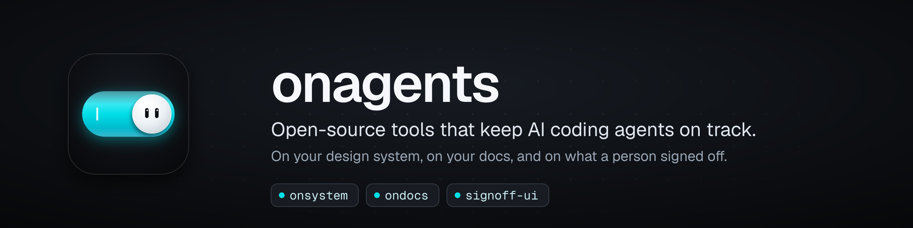

Open-source tools that keep AI coding agents on track: on your design system, on your docs, and on what a person signed off.

| Project | What it does | |
|---|---|---|
| **[onsystem](https://github.com/dgesteves/onsystem)**  | Keeps coding agents on your design system: catches palette colors, native elements and APIs your system lacks, at every edit and pull request, with the fix. Claude Code plugin, MCP server, ESLint plugin and GitHub Action. | [Docs](https://onsystem.vercel.app) · [npm](https://www.npmjs.com/package/onsystem) |
| **[ondocs](https://github.com/dgesteves/ondocs)**  | Open-source Ask AI for your docs, with an MCP server for agents: cited answers on your own model key, from one static index built with your site. No vector database. | [Docs](https://ondocs.vercel.app) · [npm](https://www.npmjs.com/package/ondocs) |
| **[signoff-ui](https://github.com/dgesteves/signoff-ui)**  | Review what your agent changed and approve what it may do: React components for multi-file diff review and tool approvals, for AI SDK 6 & 7, AG-UI and ACP agents. | [Docs](https://signoff-ui.vercel.app) · [npm](https://www.npmjs.com/package/signoff-ui) |

Built and maintained by [Diogo Esteves](https://github.com/dgesteves) in Lisbon. Issues and pull requests are welcome in each project's repository.
